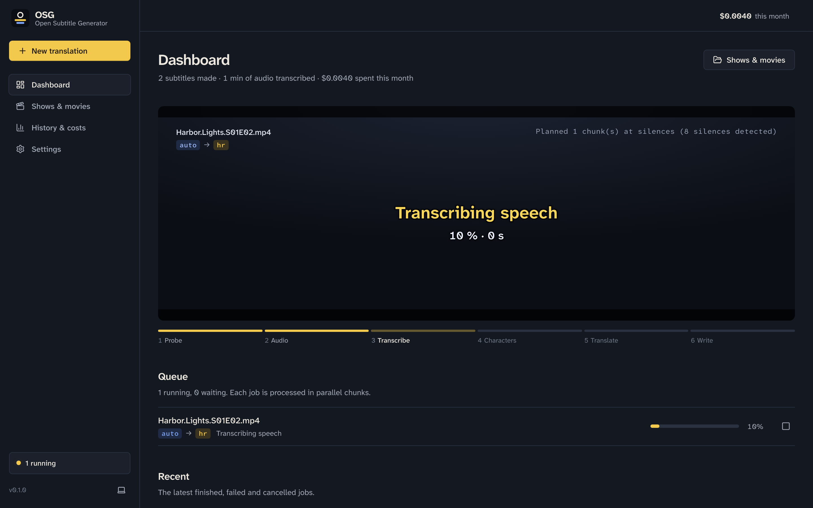
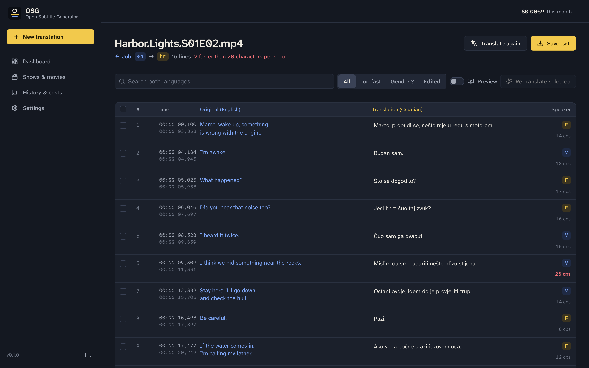
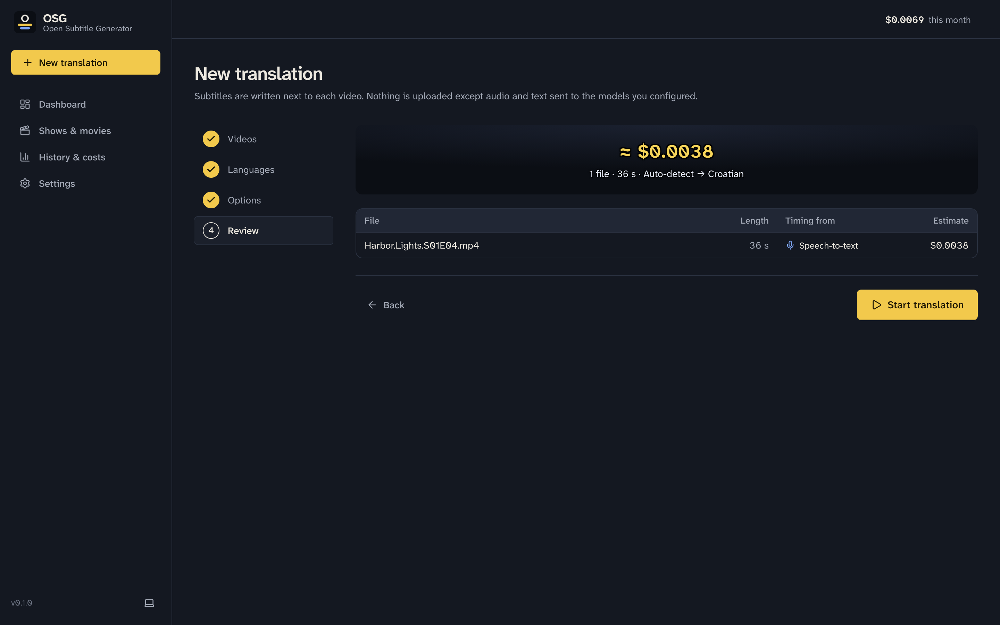
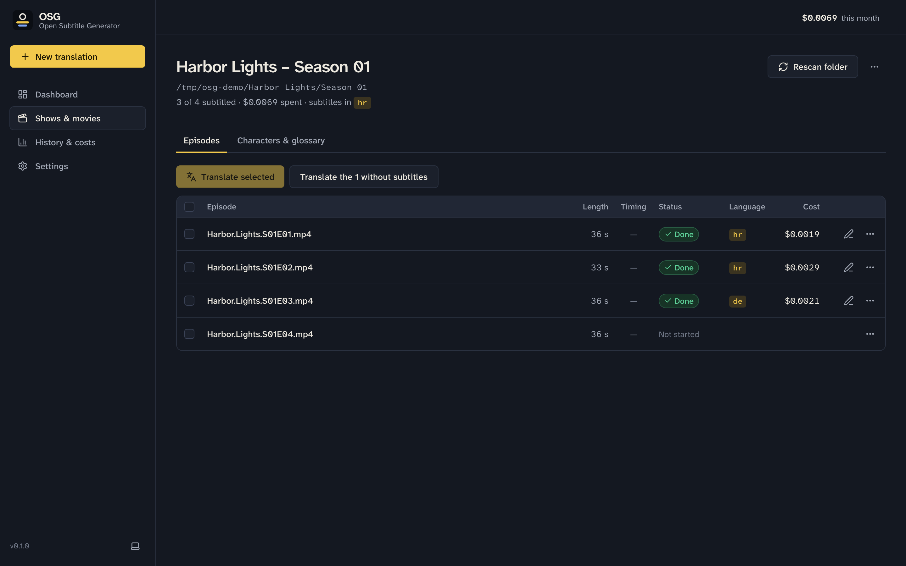
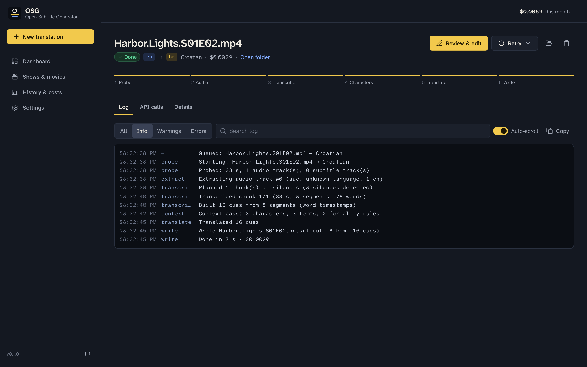
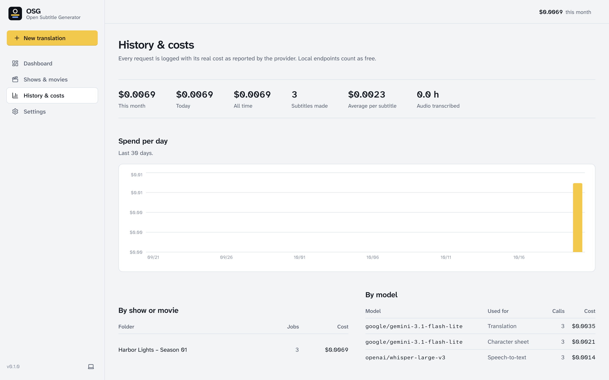
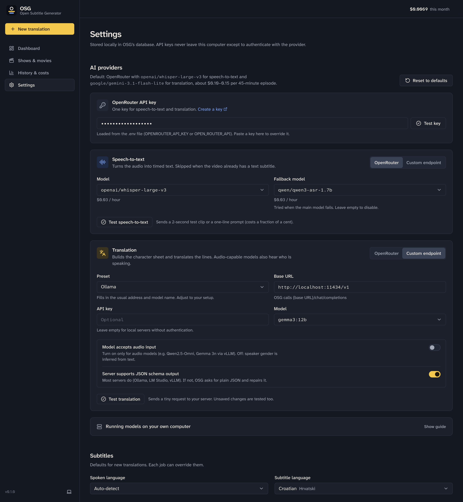
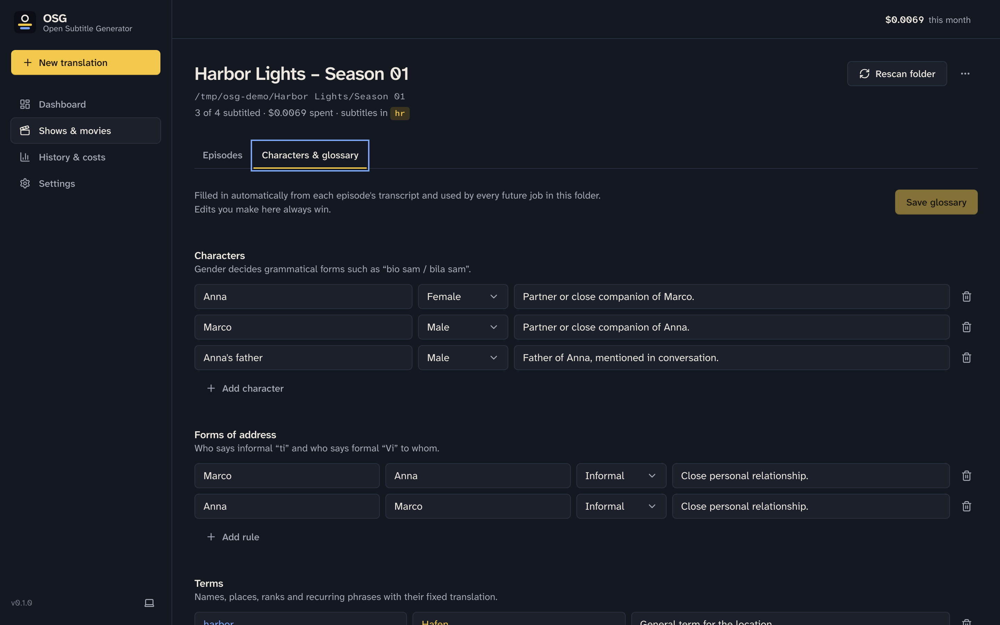

<div align="center">


# OSG · Open Subtitle Generator

**Translated `.srt` subtitles for your movies and TV episodes, made on your own computer.**

Pick a season folder, choose a language, and OSG writes `Episode.hr.srt` next to every video, ready for Plex, Jellyfin, Infuse, Kodi and VLC.

[](https://github.com/ninkovic-consulting/open-subtitle-generator/actions/workflows/ci.yml?query=branch%3Amain)


</div>



OSG is a local-first app: a small Node.js server runs on your machine and you use it through a web UI in your browser. Speech-to-text and translation run through [OpenRouter](https://openrouter.ai) by default (about **$0.10–0.15 per 45-minute episode**), or through **your own local models** on any OpenAI-compatible server.

---

## Contents

- [Features](#features)
- [How it works](#how-it-works)
- [What it costs](#what-it-costs)
- [Quick start](#quick-start)
- [Choosing models: OpenRouter or local](#choosing-models-openrouter-or-local)
- [Using OSG](#using-osg)
- [Output files and encodings](#output-files-and-encodings)
- [Privacy and security](#privacy-and-security)
- [Troubleshooting](#troubleshooting)
- [Development](#development)
- [License](#license)

## Features

- **Any language to any language.** Auto-detects the spoken language; subtitles in 50+ listed languages or any language you type in. Croatian is the default.
- **Grammatically correct gender.** The translation model gets short audio clips with every batch, so it hears who is speaking and writes “bio sam” or “bila sam”, “jesi li spreman” or “spremna” correctly. This matters for Croatian, Serbian, Bosnian, Slovenian, Polish, Russian, Czech and many more.
- **Consistent across a whole season.** Each show keeps a character sheet (names, genders, notes), forms of address (who says _ti_ and who says _Vi_), and a glossary of names and recurring terms. It is built automatically from each episode and you can edit it.
- **Uses what is already there.** If a video has an `.srt` next to it or an embedded text subtitle track (MKV/MP4), OSG translates that instead of transcribing. Cheaper, and the timing is already perfect.
- **Professional timing and layout.** Silence-aware chunking, word-level timestamps, cues of at most 2 × 42 characters and 6.5 s, no overlaps, balanced line breaks, `<i>` tags and dialogue dashes kept.
- **Correct characters for every script.** Unicode NFC (č as one character), UTF-8 with BOM by default, or legacy code pages such as Windows-1250 for old TVs, with automatic fallback so a file never contains `?` instead of a letter.
- **Review and fix.** A side-by-side editor with timestamps, speaker gender, reading-speed warnings (> 20 characters per second), search, inline editing, re-translation of selected lines and a video preview with the subtitles on top.
- **Live progress, logs and costs.** Every stage, log line and API call is visible while it happens; the real cost reported by the provider is stored per call, job, show and model.
- **Local models welcome.** Point speech-to-text, translation or both at Speaches, whisper.cpp, LocalAI, Ollama, LM Studio, vLLM, llama.cpp or any other OpenAI-compatible server. One click resets everything to the OpenRouter defaults.
- **No setup beyond Node.js.** No compiler, Homebrew, Python or Docker needed: dependencies install from prebuilt binaries and OSG downloads its own ffmpeg on first start.

| Subtitle editor                                                    | Translation wizard                                                     |
| ------------------------------------------------------------------ | ---------------------------------------------------------------------- |
|        |  |
| **Episodes of a show**                                             | **Job log and stages**                                                 |
|  |                     |

## How it works

One job turns one video into one subtitle file:

```
 video ──► 1 Probe ──► 2 Audio ──► 3 Transcribe ──► 4 Characters ──► 5 Translate ──► 6 Write ──► Episode.hr.srt
            ffprobe     ffmpeg      Whisper           character        LLM + audio      wrap,
            tracks,     mono 16 kHz silence chunks,   sheet and        clips, batches   encode,
            duration    WAV          word timestamps  glossary         of 40 lines      atomic write
                                    (skipped when an existing subtitle can be used)
```

1. **Probe** reads duration, audio tracks and subtitle tracks.
2. **Timing source** is chosen, cheapest first: a sidecar `.srt` with the same name (`Ep.srt`, `Ep.en.srt`), then an embedded text subtitle track, otherwise speech-to-text.
3. **Transcribe** extracts the audio track that matches the spoken language, cuts it at silences into chunks of about 10 minutes, transcribes them in parallel with word and segment timestamps, and builds readable cues. Only dialogue is kept: music notes, sound tags (`*Dramatic music*`, `[Screaming]`), credit lines in many languages (“Thanks for watching”, “Sous-titrage Société Radio-Canada”…) and clusters of the short phrases speech-to-text invents over music and noise (“Thank you.”, “Bye.”, “Merci.”) are removed.
4. **Characters** sends the transcript once to build or extend the show's character sheet and glossary.
5. **Translate** sends batches of about 40 cues with 8 lines of context before and 4 after, the glossary, and an audio clip of that part of the episode. When the lines come from speech-to-text, the model also listens for each short line and removes the ones nobody actually says. Answers are validated (every line present, nothing empty, sensible length); failures are retried, split into smaller batches, retried without audio, and as a last resort the original line is kept and logged.
6. **Write** wraps lines, renders SRT with CRLF line endings, encodes it, and writes it atomically next to the video.

Jobs are queued (4 at a time by default; change it in the dashboard queue or in Settings) and survive restarts: when OSG starts again, unfinished jobs continue from the last completed stage without paying for transcription twice, and open browser tabs reconnect by themselves.

## What it costs

With the defaults (`openai/whisper-large-v3` and `google/gemini-3.1-flash-lite` via OpenRouter):

| 45-minute episode                                            | Speech-to-text | Translation with audio | Total            |
| ------------------------------------------------------------ | -------------- | ---------------------- | ---------------- |
| No existing subtitles                                        | ≈ $0.02        | ≈ $0.08–0.12           | **≈ $0.10–0.15** |
| With an `.srt` or embedded subtitle track                    | –              | ≈ $0.05–0.10           | **≈ $0.05–0.10** |
| Local models ([see below](#running-models-on-your-computer)) | $0             | $0                     | **$0**           |

The wizard shows an estimate before you start, and “History & costs” shows what was really charged. Turning off “Listen to voices for gender” lowers the translation cost further.



## Quick start

You need [Node.js](https://nodejs.org) **22 or newer** and git.

```bash
git clone https://github.com/ninkovic-consulting/open-subtitle-generator.git
```

```bash
cd open-subtitle-generator && npm install
```

```bash
npm start
```

The first `npm start` builds the app, downloads ffmpeg (about 45 MB, once) and opens **http://localhost:4747** in your browser. Then:

1. Open **Settings** and paste your OpenRouter API key ([create one here](https://openrouter.ai/keys)), or set up [local models](#running-models-on-your-computer). Click **Test key**.
2. Click **New translation**, browse to a season folder and select the episodes.
3. Pick the subtitle language, check the options and the cost estimate, and click **Start**.

The subtitles appear next to the videos as they finish.

<details>
<summary>Prefer an environment variable for the key?</summary>

Copy `.env.example` to `.env` and fill in `OPENROUTER_API_KEY=…` (the alias `OPEN_ROUTER_API` also works). A key saved in Settings takes precedence over `.env`. The `.env` file is ignored by git.

| Variable                       | Default            | Purpose                                       |
| ------------------------------ | ------------------ | --------------------------------------------- |
| `OPENROUTER_API_KEY`           | –                  | OpenRouter key                                |
| `PORT`                         | `4747`             | Port of the local web UI (always `127.0.0.1`) |
| `OSG_DATA_DIR`                 | OS app-data folder | Where the database and temporary audio live   |
| `OPEN_BROWSER`                 | `1`                | Set to `0` to not open the browser on start   |
| `FFMPEG_PATH` / `FFPROBE_PATH` | bundled binaries   | Use your own ffmpeg build instead             |
| `LOG_LEVEL`                    | `info`             | `debug`, `info`, `warn`, `error`              |

</details>

## Choosing models: OpenRouter or local

**Settings → AI providers** configures speech-to-text and translation separately. Each can use **OpenRouter** (one API key for both) or a **custom endpoint**: any server that speaks the OpenAI API, with its own base URL and optional API key. You can mix them, for example local Whisper for transcription and Gemini on OpenRouter for translation.



**Defaults** (restored any time with **Reset to defaults**):

| Step           | Provider   | Model                          | Notes                                                       |
| -------------- | ---------- | ------------------------------ | ----------------------------------------------------------- |
| Speech-to-text | OpenRouter | `openai/whisper-large-v3`      | Word + segment timestamps. Fallback: `qwen/qwen3-asr-1.7b`. |
| Translation    | OpenRouter | `google/gemini-3.1-flash-lite` | Accepts audio, structured JSON output, very low price.      |

The model pickers list the current OpenRouter catalog with prices, so you can switch to any other transcription or chat model. Models that accept audio are marked.

### Running models on your computer

Choose **Custom endpoint**, pick a preset or type the base URL, and click **Test**. OSG then calls `{base URL}/audio/transcriptions` and `{base URL}/chat/completions`. Local requests cost nothing and the audio never leaves your machine.

**1. Speech-to-text needs a Whisper server** with an OpenAI-compatible `/v1/audio/transcriptions` endpoint that returns `verbose_json` with timestamps. Word timestamps give the best timing; segment timestamps also work (OSG detects this automatically). Use large-v3 or large-v3-turbo for languages other than English; small models miss words and hallucinate on silence.

| Server                                                                                        | Base URL                         | Model id                          |
| --------------------------------------------------------------------------------------------- | -------------------------------- | --------------------------------- |
| [Speaches](https://github.com/speaches-ai/speaches) (formerly faster-whisper-server), CPU/GPU | `http://localhost:8000/v1`       | `Systran/faster-whisper-large-v3` |
| [whisper.cpp](https://github.com/ggml-org/whisper.cpp) server, fast on Apple Silicon          | `http://localhost:8080/v1`       | any (the loaded model is used)    |
| [LocalAI](https://localai.io)                                                                 | `http://localhost:8080/v1`       | your Whisper model name           |
| [Groq](https://console.groq.com) (cloud, OpenAI-compatible, very fast)                        | `https://api.groq.com/openai/v1` | `whisper-large-v3`                |

For whisper.cpp, start the server with the OpenAI-style path, for example:

```bash
./build/bin/whisper-server -m models/ggml-large-v3.bin --port 8080 --inference-path /v1/audio/transcriptions
```

**2. Translation needs a chat model** behind `/v1/chat/completions`:

| Server                                                    | Base URL                    | Example model                  |
| --------------------------------------------------------- | --------------------------- | ------------------------------ |
| [Ollama](https://ollama.com)                              | `http://localhost:11434/v1` | `gemma3:12b`, `gemma3:27b`     |
| [LM Studio](https://lmstudio.ai)                          | `http://localhost:1234/v1`  | the model loaded in LM Studio  |
| [vLLM](https://docs.vllm.ai)                              | `http://localhost:8000/v1`  | `Qwen/Qwen2.5-Omni-7B` (audio) |
| [llama.cpp](https://github.com/ggml-org/llama.cpp) server | `http://localhost:8080/v1`  | the loaded GGUF                |

```bash
ollama pull gemma3:12b
```

- Pick a model that writes your subtitle language well. For Croatian and other Slavic languages, 12B+ models are a sensible minimum; 27B and up get noticeably closer to Gemini.
- **Hearing who speaks** needs an audio-understanding model that accepts `input_audio` content, such as Qwen2.5-Omni or Gemma 3n served with vLLM. Turn on **Model accepts audio input** only for those. With text-only models leave it off; OSG then infers speaker gender from names, the character sheet and context.
- **JSON schema output** is supported by Ollama, LM Studio and vLLM. If your server rejects it, OSG falls back to plain JSON automatically and repairs fenced or chatty answers.
- If speech-to-text and translation both run locally, no OpenRouter key is needed at all.

## Using OSG

**Shows & movies.** Add a folder (a season, a whole show or a movie). OSG lists every video in it, including subfolders, with its length, whether an existing subtitle can be used for timing, the status of the latest job, and what it cost. Select episodes and click **Translate selected**, or translate all episodes that do not have subtitles yet. To start over, use **Delete subtitles** in an episode's menu (or for several selected episodes): it deletes the `.srt` OSG wrote, never your videos or other subtitle files, and can keep the translation in OSG so you can save it again later.

**Characters & glossary.** Each folder has its own character sheet (name, gender, notes), forms of address (who uses informal or formal speech with whom), terms with fixed translations, and style notes. OSG fills it from every episode; your edits always win and are used by every future job in that folder.



**New translation.** Four steps: choose videos (search the current folder, or switch on **Include subfolders** to find an episode anywhere below it), languages, options (existing subtitles, voice-based gender, models, encoding, file name, overwrite), then review the cost estimate. If an output file already exists, OSG asks before replacing it; jobs that would overwrite without permission stop before any paid request.

**Jobs.** Each job shows its six stages, live progress, a searchable log (copy it into a bug report), every API call with tokens and cost, and details such as the detected language and encoding. Failed jobs can be retried, either keeping finished stages or from a specific stage.

**Editor.** Original and translation side by side. Click a line to edit it, click a timecode to adjust timing, click the speaker badge to change the gender, filter lines that are read too fast or have an unknown speaker, re-translate selected lines with full context, or translate the whole episode into another language without transcribing again. **Save .srt** writes your edits to disk in the encoding you choose. **Preview** plays the video with the subtitles on top (MP4 and WebM play in every browser; MKV depends on the codecs).

## Output files and encodings

Subtitles are always written next to the video:

| Naming (Settings → Subtitles) | Example                       | Picked up automatically by              |
| ----------------------------- | ----------------------------- | --------------------------------------- |
| Language suffix (default)     | `Harbor.Lights.S01E01.hr.srt` | Plex, Jellyfin, Emby, Infuse, Kodi, VLC |
| Same name as the video        | `Harbor.Lights.S01E01.srt`    | players that only look for that name    |

The subtitle used as the timing source is never overwritten (OSG writes `….osg.srt` instead if the names collide), and files are written atomically (`.part`, then renamed).

| Encoding                     | When to use it                                                                 |
| ---------------------------- | ------------------------------------------------------------------------------ |
| **UTF-8 with BOM** (default) | Works for every language. The BOM helps TVs and older players recognise UTF-8. |
| UTF-8 without BOM            | For tools that dislike the BOM.                                                |
| Legacy code page             | For old TVs that only read the regional Windows code page.                     |

Legacy code pages are chosen from the subtitle language: Windows-1250 (Croatian, Bosnian, Serbian Latin, Slovenian, Polish, Czech, Slovak, Hungarian, Romanian, Albanian), 1251 (Serbian Cyrillic, Macedonian, Russian, Ukrainian, Bulgarian), 1252 (Western European), 1253 (Greek), 1254 (Turkish), 1255 (Hebrew), 1256 (Arabic, Persian), 1257 (Baltic), 1258 (Vietnamese), 874 (Thai), 932 / 949 / GB18030 / Big5 (CJK). If a single character does not exist in that code page, the file is written as UTF-8 with BOM instead and the log says so.

Existing subtitles are read in any common encoding: BOM and UTF-16 detection, strict UTF-8, charset detection, then Windows-1250 as the usual encoding of older Balkan subtitles.

**Supported videos:** MKV, MP4, M4V, AVI, MOV, WMV, TS, M2TS, WebM, FLV, MPG, 3GP, OGV, DivX, VOB, anything ffmpeg can read. **Usable existing subtitles:** `.srt` files and embedded SubRip, ASS/SSA, mov_text and WebVTT tracks.

## Privacy and security

- **What leaves your computer:** with OpenRouter, the audio of the episode (as compressed MP3 chunks and short clips) and the subtitle text are sent to OpenRouter and the model providers it routes to. Read the [OpenRouter privacy policy](https://openrouter.ai/privacy) and the policies of the models you choose. With custom endpoints, data goes only to the server you configured. Nothing else is uploaded; there is no telemetry.
- **Your key stays local.** API keys are stored in the local SQLite database (or read from `.env`), are never logged, and the UI only ever receives a masked version.
- **The server is reachable only from your computer.** It binds to `127.0.0.1`, checks the `Host` header (against DNS rebinding) and the `Origin` header, and every API call needs a random session token that is created at each start and embedded only in the page OSG serves, so other websites cannot use your local OSG.
- **Limited file access.** The file browser shows only folder names, video files and `.srt` files. OSG writes only `.srt` files, and only next to videos you selected.
- **Data folder:** macOS `~/Library/Application Support/osg`, Windows `%LOCALAPPDATA%\osg\Data`, Linux `~/.local/share/osg` (shown in Settings → Advanced). Temporary audio is deleted when a job ends.

## Troubleshooting

<details>
<summary><strong>“Could not download ffmpeg” or “Could not start ffmpeg”</strong></summary>

OSG installs dependencies without running their install scripts (see `.npmrc`), so nothing needs a compiler. The one binary that is not bundled, ffmpeg, is downloaded on the first start from the [ffmpeg-static](https://github.com/eugeneware/ffmpeg-static) releases. Behind a proxy, set `HTTPS_PROXY`; without internet access, install ffmpeg yourself and set `FFMPEG_PATH=/path/to/ffmpeg` (and optionally `FFPROBE_PATH`) in `.env`.

</details>

<details>
<summary><strong>The video has subtitles, but OSG still transcribes</strong></summary>

Only text subtitles can be translated directly. Image-based tracks (PGS from Blu-ray, VobSub from DVD) would need OCR, which OSG does not do; the log says “Skipping image-based subtitle track”. Also check that **Use existing subtitles for timing** is on, and that the existing subtitle is not already in the target language.

</details>

<details>
<summary><strong>The transcript is in the wrong language or mostly empty</strong></summary>

The episode may have several audio tracks (original, dubbed, commentary). OSG picks the track whose language tag matches the spoken language you chose, otherwise the first track. Set the spoken language explicitly in the wizard instead of Auto-detect, and check the audio tracks listed in the job log.

</details>

<details>
<summary><strong>Lines are read too fast or wrap oddly</strong></summary>

Use the **Too fast** filter in the editor, shorten lines by hand or select them and click **Re-translate selected**. Cues follow the usual limits of two lines of 42 characters and at most 6.5 seconds.

</details>

<details>
<summary><strong>“OpenRouter 401 / 402”</strong></summary>

401 means the key is wrong or revoked; 402 means the account has no credits left. Use **Settings → Test key**, which also shows your usage and limit.

</details>

<details>
<summary><strong>A custom endpoint does not work</strong></summary>

Click **Test** next to it. “Nothing is listening at …” means the server is not running or the port is different. Make sure the base URL ends in `/v1` (or wherever your server mounts the OpenAI API) and that the model id matches what the server has loaded. If your translation server does not support JSON schema output, switch that option off.

</details>

<details>
<summary><strong>Port 4747 is already in use</strong></summary>

Another OSG is probably running. Close it, or start with `PORT=4848 npm start`.

</details>

## Development

```bash
npm run dev
```

starts the API server with auto-reload (`tsx watch`) and the Vite dev server with hot reload at http://localhost:5173.

| Script                | What it does                                                          |
| --------------------- | --------------------------------------------------------------------- |
| `npm start`           | Build if needed, start the server, open the browser                   |
| `npm run dev`         | Server + Vite dev server with hot reload                              |
| `npm run build`       | Build the web UI (`dist/web`) and the server (`dist/node`)            |
| `npm test`            | Unit and integration tests (Vitest, with fake and mock providers)     |
| `npm run test:e2e`    | Playwright smoke test: settings → job → editor                        |
| `npm run test:live`   | Optional calls to the real OpenRouter API (needs a key, < $0.01)      |
| `npm run lint`        | ESLint + Prettier check                                               |
| `npm run typecheck`   | TypeScript for server, web and tests                                  |
| `npm run db:generate` | Generate a Drizzle migration after changing `src/server/db/schema.ts` |
| `npm run db:migrate`  | Apply migrations (also done automatically on start)                   |

**Stack:** Node.js 22+, TypeScript (strict, ESM), Fastify, Server-Sent Events, SQLite (better-sqlite3 + Drizzle ORM), ffmpeg-static / ffprobe-static, the official `@openrouter/sdk`, React 19, Vite, Tailwind CSS 4, Radix UI primitives in the shadcn/ui style, TanStack Query, React Router, Vitest and Playwright.

```
src/
  server/
    index.ts            bootstrap (127.0.0.1, opens the browser)
    app.ts              Fastify app, static web UI, error handling
    security.ts         Host/Origin checks, per-launch session token
    db/                 Drizzle schema, client, migrations
    routes/             settings, models, fs, projects, jobs, cues, stats, events (SSE), media
    providers/          OpenRouter (SDK) and OpenAI-compatible adapters behind one interface
    services/
      media.ts          ffprobe / ffmpeg wrappers, sidecar detection
      chunker.ts        silence-aware chunk planning
      stt.ts            parallel transcription, hallucination filter
      cues.ts           words + segments → timed, readable cues
      context.ts        character sheet / glossary pass
      translate.ts      batched translation with audio, validation, retries
      srt.ts            parse, render, wrap, NFC, encodings
      pipeline.ts       one job, stage by stage, resumable
      queue.ts          persisted job queue with cancellation
  shared/               types, zod schemas, languages (used by server and web)
  web/                  React app: pages, components, API client, SSE
tests/                  unit, integration (generated ffmpeg fixtures), mock OpenAI server, e2e
```

Adding another provider means implementing `SttProvider` or `ChatProvider` in `src/server/providers/types.ts`. See [CONTRIBUTING.md](CONTRIBUTING.md) for guidelines.

## License

OSG is released under the [MIT License](LICENSE).

Third-party software keeps its own license: the OpenRouter SDK is Apache-2.0; `ffmpeg-static` and `ffprobe-static` download FFmpeg builds (GPL/LGPL) at install time, which are not part of this repository; fonts are Atkinson Hyperlegible Next and Mono by the Braille Institute (SIL Open Font License). Subtitles you generate are yours; respect the rights of the videos you subtitle.
